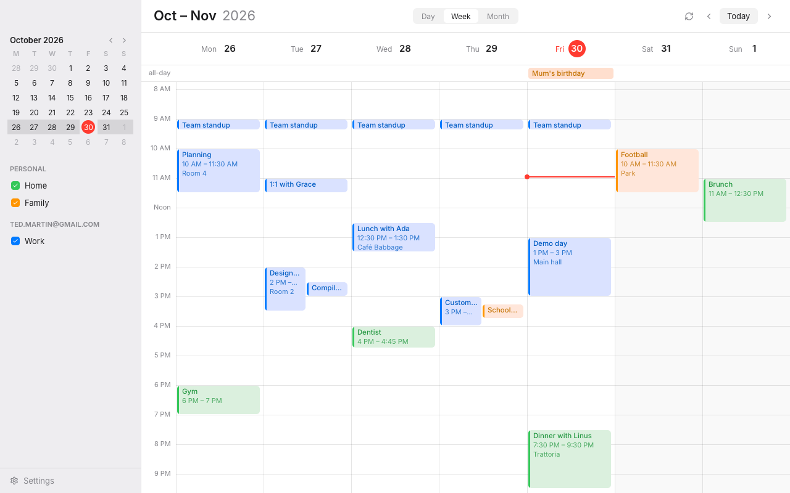

# Rune Calendar

A desktop calendar in Rust on [Rune](https://github.com/anomalyco/rune), on the same stack as
Rune Mail: Day, Week and Month views of your CalDAV calendars, any number of accounts.



## Build

```sh
cargo run --release
```

### Install in the launcher and dock (GNOME)

```sh
scripts/install.sh calendar --dock
```

builds a release, installs it as `~/.local/bin/rune-calendar` with its icon and launcher entry under
`~/.local/share`, and pins it to the dock (leave off `--dock` to skip that).

## Accounts

**Settings → Accounts → Add Account…** (or the sidebar on first run) signs in with an app password:

- **Fastmail**: Settings → Privacy & Security → Manage app passwords, with Calendars (CalDAV) access.
  Every calendar shows.
- **Google**: an app password from myaccount.google.com/apppasswords (2-Step Verification on).
  Google's endpoint for app passwords serves the primary calendar.
- **iCloud**: your Apple Account address and an app-specific password.
- **Other**: any CalDAV server; the address of its calendars or its `/.well-known/caldav`.

**Add from Rune Mail** adds the Fastmail and Gmail calendars Rune Mail already signs in to, with
their labels, without asking for the passwords again. Passwords are kept in the system keyring
(without one, in `~/.config/rune-calendar/accounts.json`, readable only by you). Each account has a
label for the sidebar and a place in its order; each calendar a switch for whether it shows.

## What works

- Day and Week: the 24 hours with all-day events above, overlapping events side by side, weekends
  shaded and a red line for now; they open at 8 AM (or the hour set in Settings)
- Month: six weeks, each day listing what fits with "n more"; a day's number opens it in Day
- The sidebar: a small month to jump around, then each account's calendars in their colours
- An event's details beside it, as Apple Calendar's popover: change the title, location, video call
  link, invitees and notes in place; closing them (a click outside, or Escape) saves to the server.
  Notes show as text, without an invitation's HTML or Google's joining instructions (which are kept
  when you edit). A call found in the event's conference, URL, location or notes gets a Join button.
  Invitees show their replies; you can add and remove them on your own events, not on invitations.
  A change to a repeating event applies to the whole series.
- Accounts sign in and load side by side, so a slow server holds up only its own calendars; the
  months either side of the one shown load too, so paging is instant
- Recurring events are expanded by the server; times in named zones convert to yours
- Checks for changes every 5 minutes (1/5/15/manual in Settings), or Ctrl+R
- Light and dark, following the system or set in Settings; weeks start Monday or Sunday

Making events, deleting them and changing their times come next.

## Keyboard

| Keys | |
| --- | --- |
| `d` `w` `m` | Day, Week, Month |
| `t` | Today |
| ← → (or `h`/`l`, `k`/`j`) | Back, on |
| Ctrl+R | Check for changes |
| Ctrl+, | Settings |
| Escape | Close details or a sheet |

## Layout of the code

- `src/caldav.rs`: CalDAV discovery, event ranges and iCalendar parsing
- `src/worker.rs`: the network side; the UI sends `Cmd`s and gets `Event`s back
- `src/app.rs`: state, navigation and accounts; `src/accounts.rs`, `src/secrets.rs`: saved
  accounts, the keyring, importing Rune Mail's
- `src/ui/`: the sidebar, the Day/Week grid, Month, sheets, palette and icons (Lucide, ISC)
- `src/demo.rs`: offline sample calendars for headless snapshots:
  `cargo run -- --snap out.png --scene week|day|month|details|settings|add|empty [--theme dark]`
