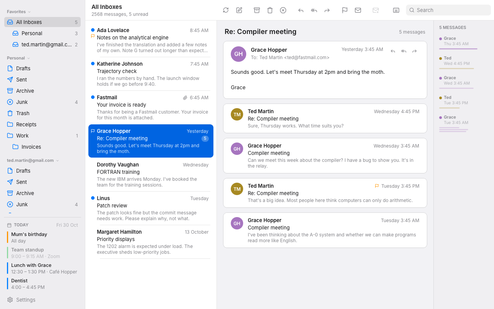

# Rune Mail

A mail client in Rust, laid out like Apple Mail and drawn with [Rune](https://github.com/anomalyco/rune).
Fastmail accounts talk JMAP; Gmail and other accounts use IMAP and SMTP.



## Build

Linux needs the XKB and Wayland development packages:

```sh
sudo apt-get install -y libxkbcommon-dev libwayland-dev pkg-config
cargo run --release
```

### Install in the launcher and dock (GNOME)

```sh
scripts/install.sh mail --dock
```

builds a release, installs it as `~/.local/bin/rune-mail` with its icon (`assets/rune-mail.svg`) and
launcher entry (`assets/rune-mail.desktop`) under `~/.local/share`, and pins it to the dock (leave
off `--dock` to skip that). The window reports the app id `rune-mail`, so the dock shows it with
the icon. Run it again after pulling changes to update the installed copy.

## Connect Fastmail

On first launch, paste an API token: in Fastmail open **Settings → Privacy & Security → Manage API
tokens** and create one with **Email** and **Email submission** access. Add more accounts from
**Settings → Accounts → Add Account…**. Tokens are saved to `~/.config/rune-mail/accounts.json`
(mode 600); an older single `token` file is moved in automatically. `FASTMAIL_TOKEN=… cargo run`
adds an account without saving it.

### Gmail and other accounts

**Settings → Accounts → Add Account…** (or the first-run window) offers Fastmail, Gmail and Other:

- **Gmail**: your address and an app password (turn on 2-Step Verification, then create one at
  myaccount.google.com/apppasswords). Gmail's All Mail is where Archive goes.
- **Other (IMAP)**: address, password, IMAP server (TLS on 993) and SMTP server (TLS on 465, or
  STARTTLS on 587), and whether to save sent mail to Sent (off for providers that file it themselves).

Passwords are saved in `accounts.json` with the tokens. In **Settings → Accounts** each account
has a label (what the sidebar and the From picker call it, seen only by you; empty shows the
address), a name on sent mail (what recipients see; empty uses the server's), up/down
arrows to set the sidebar's order, and a Calendar switch. Over IMAP, conversations are grouped from
the References headers of the messages in the mailbox shown, so replies in Sent aren't included the
way they are with Fastmail. Calendars are Fastmail-only for now.

### Today's events

Fastmail's API tokens don't cover calendars (JMAP Calendars is still an IETF draft), so the
sidebar's Today panel reads them over CalDAV. A Gmail account, or a Fastmail account added over
IMAP, shows its calendar with the app password it already has (Google's app-password CalDAV endpoint
serves the primary calendar); turn it off with the Calendar switch. For a Fastmail account added with
an API token, open **Settings → Privacy & Security →
Manage app passwords**, create one with **Calendars (CalDAV)** access, and paste it after turning on that account's Calendar switch in **Settings → Accounts**. Events from every connected account show, all-day
first; ones in progress are tinted and past ones dimmed. They refresh every five minutes and at
midnight.

### Contacts

To and Cc suggest addresses as you type: your address books first, then people you've had mail
from or sent to, matched on any word of the name or the start of the address. ↑/↓ choose, Enter takes
one and stays for the next address, Tab takes one and moves on to the next field, Esc puts the list away, and a click works too.
Address books come over CardDAV from Fastmail, with an IMAP account's own app password or a
Fastmail API-token account's calendar app password, on connecting and every half hour. Gmail
accounts suggest from mail only for now.

## Copy for AI

Rune Mail doesn't talk to an AI model itself. **Copy for AI** (the sparkles button, Ctrl+Shift+C, or
`y` in vim mode) puts the open conversation, or the marked ones, on the clipboard as a prompt for
your own tool: your prompt first (a summary prompt by default; edit it in Settings), then each
message oldest first with sender, date and recipients. Quoted replies are dropped, since the
earlier messages are already there, and bodies that haven't loaded are fetched first.

## Local storage

Off by default: mail stays on the server, each message downloads when you open it, and nothing is
written to disk (actions made offline wait in memory until the network's back). **Settings →
Storage → Keep mail on this computer** turns it on, keeping the newest mail of every account in
`~/.local/share/rune-mail/mail.db`, up to a budget you choose (250 MB, **1 GB** by default, 5 GB,
10 GB, or no limit). A meter shows what's used ("312 MB of 1 GB · 4,210 messages · back to 12 March"),
with Clear to start over. Turning it off deletes everything, after saying how much.

- **Downloaded ahead, newest first.** A background thread with its own connections lists every
  mailbox (Junk aside), then fetches bodies and attachments newest first until the budget is nearly
  used, and tops up as mail arrives. It never marks anything read and never fetches remote images.
  On a metered connection (NetworkManager's say) it waits, unless you allow it.
- **The oldest goes first.** When it's full, the oldest mail by date goes, except what you opened
  in the last week; lowering the budget prunes at once. Size is measured from the file itself, and
  freed space goes back to the disk.
- **Compact.** HTML is kept compressed and parsed again when opened; attachments (25 MB each at
  most) are kept compressed too and count toward the budget.
- **Encrypted.** The database is SQLCipher, with a random key in the system keyring (or a file only
  you can read when there's no keyring). A database it can't read is rebuilt, not trusted.
- **Remote images**: kept only with **Keep remote images** on, and only for messages where you
  loaded them; trackers stay blocked either way.
- **Instant start, local search, change-only refreshes.** The window opens on the accounts and list
  you last saw, before anything connects; search shows kept matches at once while the server's join
  them. Each check asks every account whether anything changed first (JMAP state, IMAP STATUS with
  HIGHESTMODSEQ) and only reloads those that did.
- **Secrets are in the keyring.** Tokens and passwords live in the system keyring (GNOME Keyring,
  KWallet); without one they stay in `accounts.json`.

## Privacy

- **Remote images are off** until you load them for a message (or turn them on in Settings):
  loading one tells the sender when and where you read it.
- **Trackers are always blocked**, even with remote images on: spy pixels (tiny or hidden images)
  and known open-tracking endpoints (Mailchimp, SendGrid, HubSpot, Mailgun, Postmark, Amazon SES,
  Klaviyo, Mailtrack, Superhuman, Mixmax and others, in `src/privacy.rs`) never load. Each message
  says what was blocked.
- **Links are cleaned** when you open them: redirect wrappers (Google, Outlook Safe Links,
  Facebook…) are unwrapped and analytics parameters (`utm_*`, `fbclid`, `gclid`, `mc_eid`, …)
  dropped. Click trackers that encode the destination can't be unwrapped; the message says which
  service tracks its links.
- Read receipts are never sent. Mail sent over SMTP uses a random Message-ID and EHLO name at your
  address's domain, not this computer's name, and image requests send a common browser User-Agent.

This is pattern matching, so a sender can still track a loaded image served from its own domain
under an innocent name; that's why remote images stay off by default.

## Unsubscribe

Mailing-list mail shows "This message is from a mailing list" with **Unsubscribe** (also in the
toolbar, `Ctrl+Shift+X`, or `X` in vim mode). It asks first, saying how: one click (RFC 8058, a
POST with no page to visit) when the list supports it, else an unsubscribe email from that
account, else the list's web page. Press again, or the button, to go ahead; Esc cancels.

## What works

- Several Fastmail accounts: All Inboxes plus each inbox under Favorites, then a section per account;
  actions on a mixed selection go to each message's own account; compose has a From picker
- Sidebar with Favorites (Inbox, Drafts, Sent, Archive, Junk, Trash) and your folders, with unread counts
- Today's events from your calendars at the bottom of the sidebar
- Sidebar sections (Favorites and each account) fold away like an accordion: click the header.
  A folded section shows its unread count; which are folded is remembered, and `J`/`K` skip them
- Conversations: one row per thread with a message count (unread, flagged or with attachments if
  any message is); the reader stacks the whole thread, newest on top, with a map down its right edge
  (one block per message in the sender's colour, as long as its text, a click to jump). Messages
  not open show like list rows: sender, exact time, subject, two preview lines. `l` (or →) moves
  the keyboard from the list into the conversation, where `j`/`k` walk its messages; `h` (←, Esc)
  goes back. Moving with `j`/`k` (or `gg`/`G`) opens the message you land on and closes the others,
  like an accordion, and scrolls it to the top of the reader. Space opens or closes the highlighted message, `o` opens or closes them all, and replies,
  forwards, `S` (flag), `U` (unread) and `i` (remote content) act on the highlighted message.
  Replies from Sent are included; Trash and Junk copies aren't, unless you're in that mailbox.
  Archive and Delete move the thread's messages in the mailbox shown. Turn it off, or put the newest
  message at the bottom, in Settings.
- Message list with unread dots, flags, attachments, and 0–3 preview lines (newest 200 per mailbox)
- HTML email drawn natively: styled text, links, inline (`cid:`) and data images, tables as rows and
  boxes, lists, quotes and backgrounds. Remote images stay off until you load them for a message, or turn
  them on in Settings. Mail with its own colours keeps them on a light page in dark mode.
- Plain-text mail with clickable links; selectable, copyable text in both
- Swipe with two fingers on a message: left reveals Flag, Archive and Delete, right reveals
  Read/Unread; let go past half-way to keep them open, or swipe all the way to act (left archives,
  or deletes, per Settings; right toggles read). Vertical swipes still scroll.
- Drag messages onto any mailbox in the sidebar to move them (all marked ones if you drag a marked
  one); the mailbox lights up under the pointer. Mail moves within its own account.
- Multi-select: `x`, Ctrl+Click, Shift+Click, Shift+↑/↓; Archive, Delete, Junk, Flag and Read act on all marked
- Reply, Reply All, Forward and a compose sheet with a From select (the system's pop-up menu on
  macOS, a list under it elsewhere) (Return makes a new line; Ctrl+Return sends)
- Attachments: the paperclip in compose opens the system's file chooser (the desktop portal on
  Linux), or drop files anywhere on the compose sheet; a strip under the body lists them with
  thumbnails, sizes and remove buttons (25 MB in all). Paste an image into the body and it goes in
  at the caret as an "Image 1" pill; the message is sent as HTML with each image inline where its
  pill is (and plain text alongside). Delete the pill and that image isn't sent.
- Undo: a sent message waits 5 s (Off/5/10/20 in Settings) with "Sending to … in 4s · Undo" at the
  bottom right, in the theme's colours; Undo reopens it as it was, and a failed send reopens it with the error. Archive, delete,
  moves, flags and read changes offer Undo for 8 s, and Ctrl+Z undoes too.
- Search in the current mailbox (Enter to search; clear the field to reset)
- Get New Mail: the toolbar's first button (it turns while checking), Ctrl+Shift+N, or `gr`
- Message bodies load on their own threads and connections: per account, one lane for messages
  you open (signed in at launch) and another for fetching ahead, so the message you open never
  waits behind a prefetch, another account or a refresh. Its preview shows at once while the rest
  loads; the newest conversations in a list are fetched ahead
  (without marking them read or loading their remote images); a failed load says why, with
  Try Again
- Attachments in received mail show as chips under the message: press one to open it in its app,
  or its arrow to save it somewhere.
- Settings (Ctrl+, or the sidebar), with a pane per topic: General, Viewing, Accounts, Privacy,
  Storage, Copy for AI and Keyboard. Saved to `~/.config/rune-mail/settings.json`.

## Keyboard

Press `?` (or Ctrl+/) for the full list. Ctrl is Cmd on macOS.

| Apple Mail–style | | Vim (on by default) | |
| --- | --- | --- | --- |
| ↑ / ↓ | Previous / next (in the active pane) | j / k | Down / up (in the active pane) |
| → / ← | Into the conversation / back to the list | l / h | Into the conversation / back to the list |
| Shift+↑ / ↓ | Extend marks | gg / G | First / last (in the active pane) |
| Delete | Trash | x | Mark |
| Ctrl+E | Archive | d / a (or e) / ! | Delete / archive / junk |
| Ctrl+Shift+J | Junk | u / s | Read / flag |
| Ctrl+Shift+U / L | Read / flag | c / r / R / f | Compose / reply / reply all / forward |
| Ctrl+N / R / Shift+R / Shift+F | New / reply / all / forward | J / K | Next / previous mailbox |
| Ctrl+1…6 | Favorites (1 is All Inboxes) | gi gd gs ga gj gt | Go to a favorite |
| Ctrl+Shift+N | Get new mail | gr | Get new mail |
| | | o | Open / close a whole conversation |
| Space | Open / close the highlighted message | S / U / i | Flag / unread / remote content, highlighted message |
| Ctrl+F | Search | / | Search |
| Space / Shift+Space | Page the message | Ctrl+D / Ctrl+U | Page the message |
| Ctrl+Shift+X | Unsubscribe (again to confirm) | X | Unsubscribe (again to confirm) |
| Esc | Cancel, clear marks, close sheets | ? | Shortcuts |

Vim keys work while no text field has focus.

Text fields edit the way the system does. Double- and triple-click select a word and a line, and
Ctrl+A, Ctrl+Z and Ctrl+Shift+Z work everywhere. Off macOS, Ctrl+Backspace and Ctrl+Delete delete
a word, Ctrl+←/→ move by word (Shift selects), Home/End go to the ends of the line, Ctrl+Home/End
to the ends of the text, and Ctrl+Y redoes (`src/ui/field.rs`).

## Layout of the code

- `src/jmap.rs`: blocking JMAP client, blob and image downloads
- `src/worker.rs`: network thread and image pool; the UI sends `Cmd`s and gets `Event`s back
- `src/html.rs`: mail HTML to a block model (parsed off the UI thread)
- `src/app.rs`, `src/actions.rs`: state, navigation, marks, message actions, compose
- `src/settings.rs`: preferences; `src/accounts.rs`: saved tokens and calendar passwords
- `src/caldav.rs`: today's events over CalDAV; `src/contacts.rs`: address books over CardDAV
- `src/privacy.rs`: tracker patterns, link cleaning, List-Unsubscribe
- `src/gestures.rs`: row swipes and drag-to-mailbox
- `src/store.rs`: the local encrypted store, its budget and search index; `src/prefetch.rs`:
  downloading ahead; `src/secrets.rs`: the keyring
- `src/ui/`: sidebar, list, reader, HTML view, compose, settings and shortcut sheets, keys, palette and
  icons (Lucide, ISC)
- `src/demo.rs`: offline sample data for headless snapshots:
  `cargo run -- --snap out.png --scene demo|single|html|thread|suggest|failed|marked|compose|settings|shortcuts|calendar|add-account [--theme dark]`
