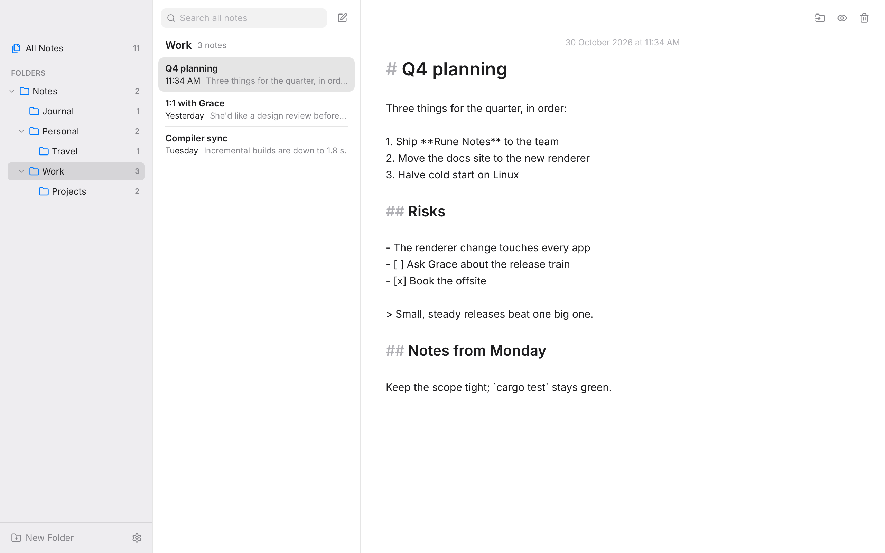

# Rune Notes

A desktop notes app in Rust on [Rune](https://github.com/anomalyco/rune), on the same stack as
Rune Mail and Rune Calendar. Notes are plain Markdown files and folders are real folders, so any
other editor can open them and git, Dropbox or Syncthing can sync them.



## Build

```sh
cargo run --release
```

### Install in the launcher and dock (GNOME)

```sh
scripts/install.sh notes --dock
```

builds a release, installs it as `~/.local/bin/rune-notes` with its icon and launcher entry under
`~/.local/share`, and pins it to the dock (leave off `--dock` to skip that).

## Where notes live

In `~/Notes`, or the folder set in **Settings → Notes folder**. Each note is a `.md` file and each
folder a folder. A note's title is its first `# heading`, else its first line, else its file name.
A new note's file is named after its title (`# Trip to Rome` → `trip-to-rome.md`, numbered if
taken) when it's first written, and keeps that name after. Deleting moves a note or folder into
`.trash` in the notes folder. Names starting with a dot (`.trash`, `.git`, `.obsidian`) are left
alone. Settings are in `~/.config/rune-notes/settings.json`.

## What works

- Apple Notes' layout: the folder tree, the selected folder's notes (title, when, first line),
  newest first, and the open note
- Folders: New Folder inside the selected one, named in place; rename (double-click or right-click);
  delete, after asking; nested folders fold open and shut; each shows its number of notes
- Notes: New Note, the Markdown source with headings set large, or the rendered Markdown (task
  boxes tick in the preview and in the file); delete; move by dragging onto a folder or with
  **Move to Folder**; All Notes shows every note
- Saves a moment after typing stops, on switching notes, on leaving the window and on closing;
  each write goes to a temporary file renamed over the note, so a note is never half written
- Picks up changes made elsewhere every few seconds and on coming back to the window. A note with
  unsaved typing isn't overwritten: if its file changed meanwhile, that version is kept beside it
  as `name (other copy).md`
- Search across the titles and text of every note
- Return carries a list on (`- `, `1. `, `- [ ] `, `> `), and ends it on an empty item; Tab indents
- Light and dark, following the system or set in Settings

## Keyboard

| Keys | |
| --- | --- |
| Ctrl+N | New note |
| Ctrl+Shift+N | New folder |
| Ctrl+F | Search; Escape clears it |
| Ctrl+E | Markdown source or preview |
| Ctrl+S | Save now |
| Ctrl+R | Look for changes now |
| ↑ ↓ | Previous, next note (outside the text) |
| Return | Edit the open note (outside the text) |
| Delete | Delete the open note (outside the text) |
| Ctrl+, | Settings |
| Escape | Close a menu or sheet, or stop naming a folder |

## Layout of the code

- `src/store.rs`: the files: scanning the tree, titles, file names, saving, folders, the trash
- `src/app.rs`: state, autosave, picking up changes, dragging notes onto folders
- `src/ui/`: the sidebar, the list, the editor and preview (rune-kit's Markdown), sheets, palette
  and icons (Lucide, ISC)
- `src/demo.rs`: sample notes in a temp folder for headless snapshots:
  `cargo run -- --snap out.png --scene notes|preview|search|all|new-folder|delete-folder|move|settings|empty [--theme dark]`
